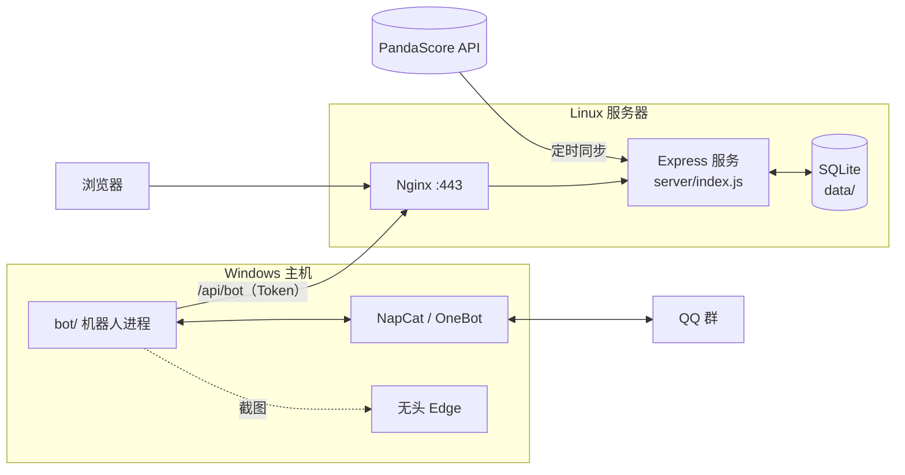

<div align="center">

<picture>
  <source media="(prefers-color-scheme: dark)" srcset="public/images/prpicklogo-light.png">
  
</picture>

### CS2 / Valorant 电竞赛事竞猜平台

赛前比分预测 · 自动积分结算 · 排行榜 · 赛事回看 · 竞猜分享图 · QQ 群机器人

[](https://nodejs.org)
[](https://expressjs.com)
[](https://github.com/WiseLibs/better-sqlite3)
[](https://pandascore.co)
[](#技术栈)
[](#license)

**[在线体验](https://prpick.gekichumai.cn)** · **[代码 Wiki](docs/wiki/README.md)** · **[机器人部署](bot/README.md)** · **[群竞猜指令](bot/COMMANDS.md)** · **[API 参考](docs/wiki/06-API参考.md)**

</div>

---

## 目录

- [简介](#简介)
- [功能特性](#功能特性)
- [积分规则](#积分规则)
- [架构](#架构)
- [快速开始](#快速开始)
- [配置](#配置)
- [常用命令](#常用命令)
- [部署](#部署)
- [QQ 群机器人](#qq-群机器人)
- [API 一览](#api-一览)
- [项目结构](#项目结构)
- [安全](#安全)
- [贡献](#贡献)

## 简介

PRPICK 是一个**纯积分、无真实货币**的中文电竞赛事竞猜站点。比赛数据通过 [PandaScore](https://pandascore.co) REST API 自动同步，用户在开赛前预测胜者与比分，赛果出炉后自动结算积分并更新排行榜。

- **零构建**：前端为原生 HTML / CSS / JavaScript，改完刷新即生效
- **单文件数据库**：Express + better-sqlite3，部署只需 Node 和一个 SQLite 文件
- **自动同步**：比赛覆盖过去 48 小时到未来 7 天；远期赛事预告默认覆盖未来 180 天
- **群内联动**：独立的 NapCat / OneBot 机器人进程推送赛程、赛果、临赛提醒，并支持群内直接竞猜

## 功能特性

<table>
<tr>
<td valign="top" width="50%">

#### 🎯 竞猜

- 按游戏（CS2 / Valorant）、赛事、状态筛选比赛
- 预测胜者与 BO1 / BO3 / BO5 合法比分
- 开赛前可修改 / 取消，完整保留变更历史
- 比赛详情：公开预测明细、赛前视角的交手记录（H2H）
- **竞猜分享图**：1080×1350 竖版卡片，队伍主色光晕、结果印章、指向赛事页的二维码，支持保存 / 复制 / 系统分享

</td>
<td valign="top" width="50%">

#### 🏆 赛事与排行

- 赛事回看：卡片 / 紧凑视图，瑞士轮 / 双败 / 单败 / GSL 完整赛程图
- 未来赛事预告：跟随游戏筛选，可收起
- 队伍中心：近期赛事、阶段名次、胜率
- 排行榜：总榜 / 赛事榜、分页、CSV 导出、得分明细
- 个人中心：预测记录与统计、公开开关、QQ 绑定

</td>
</tr>
<tr>
<td valign="top">

#### 🛠️ 管理后台 `/admin`

- 用户 / 赛事 / 队伍 / 比赛 / 预测完整 CRUD
- 赛果录入与**赛果锁定**（手动录入后同步不再覆盖）
- 弃权标记、预测开关、赛事启用 / 禁用
- 手动触发同步；赛事预告前瞻天数（7–365 天）
- 自定义未来赛事预告展示的赛事、上传赛事 logo

</td>
<td valign="top">

#### 🎨 体验

- 浅色 / 暗色主题，首帧前写入避免闪白
- 暗色模式下黑白赛事 logo 自动反色，深色彩色 logo 垫浅色底板
- 统一视觉精修层（`polish.css`）
- 移动端适配：H2H 弹窗改为分段标签
- 管理界面使用 `ops-` 前缀，规避广告拦截误杀

</td>
</tr>
</table>

## 积分规则

| 预测结果 | 得分 |
| --- | --- |
| 胜者错误 | **0** |
| 胜者正确，比分不完全一致 | **1** |
| 胜者与比分完全一致 | **满分**：BO1 = 1 · BO3 = 2 · BO5 = 3 |
| 弃权局 | **0**（正常结算，不挂起） |

> [!NOTE]
> 用户总分始终由 `predictions.points_earned` 全量重建：赛果被修正后积分会自动纠正，不会因增量计算产生偏差。

## 架构



| 层 | 技术 |
| --- | --- |
| 运行时 | Node.js ≥ 20 |
| 后端 | Express 4、better-sqlite3 |
| 鉴权 | bcryptjs、jsonwebtoken（HS256，30 天） |
| 前端 | 原生 HTML / CSS / JS，MiSans 字体子集，canvas 合成分享图 |
| 机器人 | NapCat / OneBot，系统自带 Edge（DevTools 协议）渲染图片，无 npm 依赖 |
| 测试 | `node:test` |
| 部署 | PM2 + Nginx |

## 快速开始

**前置要求**：Node.js ≥ 20，以及一个 [PandaScore API Token](https://dashboard.pandascore.co)。

```bash
git clone https://github.com/SumitaRinku/PRPick.git
cd PRPick
npm install

# 在根目录创建 .env，至少填写 PANDASCORE_API_TOKEN
echo "PANDASCORE_API_TOKEN=你的Token" > .env

npm run init-db          # 建表 + 迁移 + 创建默认管理员
npm run sync:pandascore  # 首次同步比赛（可选，服务启动后也会定时同步）
npm start
```

打开 <http://localhost:3000>：

| 页面 | 地址 |
| --- | --- |
| 首页 | `/` |
| 赛事回看 | `/tournaments.html` |
| 管理后台 | `/admin/` |
| 健康检查 | `/api/health` |

> [!IMPORTANT]
> 默认管理员用户名为 `admin`（可用 `ADMIN_USERNAME` 修改）。若未设置 `ADMIN_PASSWORD`，首次 `init-db` 会**随机生成密码并只打印一次**，请立即记录，并登录后在个人中心修改。

## 配置

所有配置通过根目录的 `.env` 提供。只有 `PANDASCORE_API_TOKEN` 是必填项。

<details>
<summary><b>服务与安全</b></summary>

| 变量 | 默认值 | 说明 |
| --- | --- | --- |
| `PORT` | `3000` | 监听端口 |
| `HOST` | `127.0.0.1` | 默认只监听本机，由 Nginx 反代 |
| `TRUST_PROXY` | `1` | 反向代理层数（限流依赖它识别真实 IP） |
| `NODE_ENV` | — | `production` / `development` |
| `JWT_SECRET` | 自动生成 | 留空时生成并持久化到 `data/.jwt_secret` |
| `ALLOWED_ORIGINS` | 全部允许 | CORS 白名单，逗号分隔 |
| `ADMIN_USERNAME` | `admin` | 默认管理员用户名 |
| `ADMIN_PASSWORD` | 随机 | 留空则初始化时打印一次 |
| `ICP_NUMBER` | — | ICP 备案号（注入页脚） |
| `ICP_LINK` | 工信部备案页 | 备案链接 |
| `BACKUP_KEEP` | `7` | 数据库备份保留份数 |
| `ALERT_WEBHOOK_URL` | — | 同步异常告警 webhook |

</details>

<details>
<summary><b>PandaScore 同步</b></summary>

| 变量 | 默认值 | 说明 |
| --- | --- | --- |
| `PANDASCORE_API_TOKEN` | — | **必填** |
| `PANDASCORE_BASE_URL` | `https://api.pandascore.co` | API 基址 |
| `PANDASCORE_SYNC_ENABLED` | `true` | 是否启用比赛与预告定时任务 |
| `PANDASCORE_SYNC_INTERVAL_MS` | `300000` | 比赛同步间隔（≥ 60000） |
| `PANDASCORE_SYNC_LOOKAHEAD_DAYS` | `7` | 比赛前瞻天数，上限 7 |
| `PANDASCORE_SYNC_RESULTS` | `true` | 是否同步赛果 |
| `PANDASCORE_REQUEST_TIMEOUT_MS` | `20000` | 单次请求超时 |
| `PANDASCORE_PREVIEW_DAYS` | `180` | 赛事预告天数默认值（后台设置优先） |
| `PANDASCORE_PREVIEW_INTERVAL_MS` | `21600000` | 预告刷新间隔（6 小时，≥ 30 分钟） |

- **比赛（近端）**：过去 48 小时到未来 7 天，默认每 5 分钟同步一次。
- **赛事预告（远期）**：调用 `/series/upcoming`，默认每 6 小时刷新，只保存赛事级信息、不导入远期比赛。
- 对阵未定的比赛使用 TBD 占位队，前台列表不显示，在赛程图中展示。

</details>

<details>
<summary><b>GRID 实时比分（可选，仅 CS2）</b></summary>

| 变量 | 默认值 | 说明 |
| --- | --- | --- |
| `GRID_API_TOKEN` | — | GRID Open Access API Key；未配置则不启用 |
| `GRID_LIVE_ENABLED` | `true` | 设 `false` 关闭 |
| `GRID_LIVE_INTERVAL_MS` | `60000` | 实时比分轮询间隔（≥ 30000） |
| `GRID_DISCOVERY_INTERVAL_MS` | `300000` | 自动配对间隔（≥ 60000） |
| `GRID_STATE_BUDGET` | `5` | 每轮最多拉取的 seriesState 数（Open Access 限额 6 次/分钟，上限 6） |
| `GRID_BASE_URL` | `https://api-op.grid.gg` | API 基址 |

- 按「双方队名 + 开赛时间（±4 小时）」把近期 CS2 比赛自动关联到 GRID series，academy / junior / NXT 等不同阵容不会互配。
- 首页进行中卡片显示系列赛实时比分与当前地图回合比分，进行中与已结束卡片显示单图比分；有进行中比赛时首页每 60 秒自动刷新。
- **只用于展示**：赛果、结算与积分仍以 PandaScore / 管理员录入为准。
- 配错或未配上时可在后台接口处理：`PUT /api/admin/matches/:id/grid-link`（`{ "series_id": "..." }`）、`DELETE /api/admin/matches/:id/grid-link?block=1`（解除并屏蔽自动配对）、`POST /api/admin/grid/sync`、`GET /api/admin/grid/status`。

</details>

<details>
<summary><b>QQ 群机器人</b></summary>

| 变量 | 说明 |
| --- | --- |
| `BOT_FEED_TOKEN` | 机器人调用 `/api/bot` 的鉴权 Token |
| `BOT_COMMAND_GROUP_IDS` | 允许群内竞猜的群号，逗号分隔 |
| `BOT_ADMIN_QQ_IDS` | 允许使用管理指令的 QQ 号，逗号分隔 |

</details>

<details>
<summary><b>生产环境 <code>.env</code> 示例</b></summary>

```bash
PORT=3000
HOST=127.0.0.1
TRUST_PROXY=1
NODE_ENV=production
JWT_SECRET=请替换为随机长字符串
ALLOWED_ORIGINS=https://your-domain.example
ICP_NUMBER=豫ICP备XXXXXXXX号
PANDASCORE_API_TOKEN=你的PandaScoreToken
BOT_FEED_TOKEN=请替换为随机长字符串
```

</details>

## 常用命令

| 命令 | 说明 |
| --- | --- |
| `npm start` | 启动服务（`npm run dev` 同效） |
| `npm run init-db` | 建表、执行迁移、创建默认管理员（`npm run migrate` 同效） |
| `npm run sync:pandascore` | 手动同步一次比赛 |
| `npm run backup` | 在线备份数据库 |
| `npm run restore -- <file>` | 从备份恢复数据库 |
| `npm run cleanup:pandascore-duplicates` | 清理历史重复数据（默认 dry-run） |
| `npm test` | 运行全部测试 |

## 部署

推荐 **Linux + PM2 + Nginx**。Node 默认只监听 `127.0.0.1`，对外只开放 80 / 443。

```bash
# 安装 Node.js 20 与 better-sqlite3 的编译依赖
curl -fsSL https://deb.nodesource.com/setup_20.x | sudo -E bash -
sudo apt-get install -y nodejs build-essential python3

npm install
npm run init-db
npm run sync:pandascore

npm install -g pm2
pm2 start server/index.js --name prg-cs2-bet-new
pm2 save && pm2 startup
```

<details>
<summary><b>Nginx 反向代理配置</b></summary>

```nginx
location / {
    proxy_pass http://127.0.0.1:3000;
    proxy_set_header Host $host;
    proxy_set_header X-Real-IP $remote_addr;
    proxy_set_header X-Forwarded-For $proxy_add_x_forwarded_for;
    proxy_set_header X-Forwarded-Proto $scheme;
}
```

</details>

更多运维细节（备份、日志、升级）见 [部署与运维](docs/wiki/08-部署与运维.md)。

## QQ 群机器人

`bot/` 是独立于网站的机器人进程，通常运行在装有 NapCat 的 Windows 主机上，通过 `/api/bot` 与网站通信。

- 📅 **每日赛程 / 昨日赛果 / 周报**：用系统自带的 Edge 渲染成与网站同风格的图片，失败时退回 GDI+ 卡片或纯文字
- ⏰ **临赛提醒**：开赛前提醒；前场拖时导致的顺延会合并进提醒，不刷屏
- 🗳️ **群内竞猜**：绑定网站账号后直接在群里竞猜、查询，结算结果自动推送
- 🔁 **自动重启**：`start.ps1` 限制内存占用，进程崩溃后自动拉起

👉 [NapCat 配置与运行教程](bot/README.md) · [群竞猜启用与指令说明](bot/COMMANDS.md)

## API 一览

| 前缀 | 用途 |
| --- | --- |
| `/api/auth` | 注册、登录、改密、预测公开开关 |
| `/api/matches` | 比赛列表与详情、提交预测、H2H |
| `/api/tournaments` | 赛事、未来赛事预告、赛程、赛事榜 |
| `/api/predictions` | 我的预测、统计、变更历史 |
| `/api/leaderboard` | 排行榜、CSV 导出、用户明细 |
| `/api/teams` | 队伍列表、赛事履历 |
| `/api/images` | 队标安全代理 |
| `/api/qrcode` | 分享图二维码 |
| `/api/admin` | 管理后台（需管理员） |
| `/api/bot` | 机器人赛程、指令、结算（需 Token） |
| `/api/bot-account` | 用户 QQ 绑定 |
| `/api/health` | 健康检查 |

完整请求与响应格式见 [API 参考](docs/wiki/06-API参考.md)。

## 项目结构

```text
.
├── server/
│   ├── config/        数据库连接、建表与迁移
│   ├── middleware/    鉴权、限流、请求日志、错误处理
│   ├── routes/        REST 路由
│   ├── services/      PandaScore 同步、赛程图模型、机器人指令与结算
│   ├── utils/         计分、结算、校验
│   └── index.js       入口
├── public/            静态前端（无构建）
│   ├── admin/         管理后台
│   ├── css/  js/      样式与页面脚本
│   └── *.html         首页、赛事回看、排行榜、个人中心、队伍、机器人报表页
├── bot/               NapCat 群机器人
├── scripts/           备份、恢复、数据清理、预览工具
├── test/              node:test 测试
├── docs/wiki/         代码 Wiki
└── data/              SQLite、JWT 密钥、上传文件、备份（不入库）
```

各模块的详细说明见 [代码 Wiki](docs/wiki/README.md)：

[项目概览](docs/wiki/01-项目概览.md) · [系统架构](docs/wiki/02-系统架构.md) · [数据库设计](docs/wiki/03-数据库设计.md) · [后端模块](docs/wiki/04-后端模块详解.md) · [前端模块](docs/wiki/05-前端模块详解.md) · [API 参考](docs/wiki/06-API参考.md) · [核心业务流程](docs/wiki/07-核心业务流程.md) · [部署与运维](docs/wiki/08-部署与运维.md)

## 安全

- 密码使用 bcrypt 哈希；修改密码后旧 JWT 立即失效
- JWT 密钥优先读取 `JWT_SECRET`，否则以 `0600` 权限持久化到本地
- 登录、注册、改密共享限流，防止暴力破解
- 默认仅监听 `127.0.0.1`，强制经过反向代理访问
- 队标代理防 SSRF；上传 logo 校验文件头（magic bytes）；所有输出统一转义
- HTML 响应禁用缓存，避免部署后浏览器继续使用旧页面

> [!CAUTION]
> `.env`、`bot/config.json` 与 `data/` 下的数据库和密钥已在 `.gitignore` 中排除，切勿提交到仓库。

## 贡献

欢迎提交 Issue 与 Pull Request。提交前请确认：

```bash
npm test   # 所有测试通过
```

- 前端保持无框架、无构建，不引入打包工具
- 新增接口或数据表时同步更新 `docs/wiki/` 中的对应文档

## License

[MIT](https://opensource.org/licenses/MIT)
